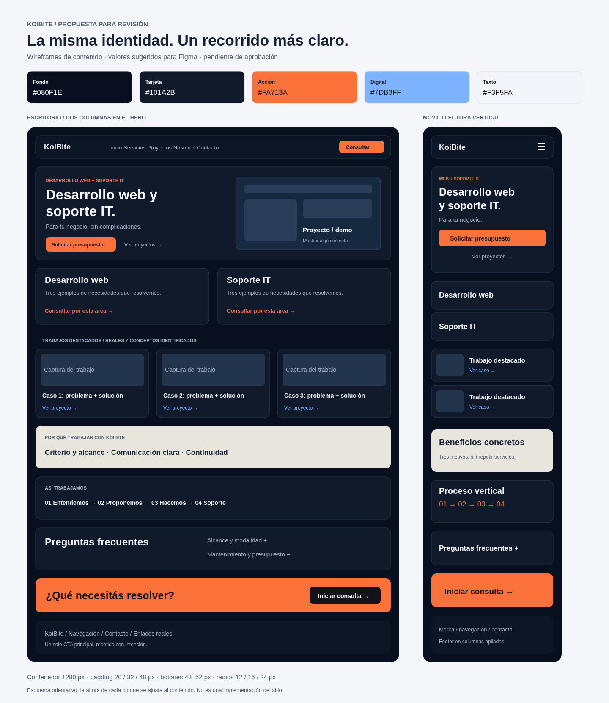

# KoiBite: feedback y guía de diseño propuesta

Referencia: https://github.com/uriel-olg/web-Koi-Soft · rama `main` · commit `1a70d7f1d0ee25ea1b56ae86c558265a9dbd1017`.

Se ejecutó una copia local del repositorio y se revisaron Inicio, Servicios, Proyectos, Nosotros y Contacto a 390, 768, 1024 y 1440 px. El dominio publicado no fue accesible desde esta red; esta revisión corresponde al código del repositorio. Durante la revisión no se modificó el código de la aplicación ni se enviaron consultas o correos.

Las medidas siguientes son una propuesta para aprobar antes de implementarla.

## Material visual

- [Wireframe propuesto, escritorio y móvil](wireframe-propuesto.png).
- [Wireframe en SVG para importar en una herramienta de diseño](wireframe-propuesto.svg).
- [Captura de la web revisada en escritorio](actual-desktop.png).
- [Captura de la web revisada en móvil](actual-mobile.png).
- [Recorte del navbar observado a 768 px](problema-navbar-tablet.png).



## 1. Dirección visual y diagnóstico

KoiBite ofrece desarrollo web y soporte IT para negocios y profesionales. Su objetivo principal debería ser transformar una necesidad en una consulta: el visitante debe entender qué resolvés, encontrar un ejemplo relevante y saber cómo contactarte.

La identidad actual tiene una base sólida: azul muy oscuro, naranja, ilustraciones de interfaces, tarjetas redondeadas y un bloque claro que interrumpe el fondo oscuro. Los botones principales se distinguen y el texto oscuro sobre naranja tiene buen contraste.

Mantendría esa identidad. Mejoraría tres cosas:

- **Claridad:** expresar el servicio antes que una promesa amplia. Propuesta de H1: «Desarrollo web y soporte IT para tu negocio». Bajada: «Creamos tu presencia online y mantenemos listos los equipos que usás para trabajar».
- **Confianza:** mostrar capturas reales de trabajos propios o de clientes, con permiso. Identificar por separado los conceptos. Home presenta «soluciones reales», mientras que Proyectos explica que muestra casos conceptuales: ambos mensajes necesitan ser coherentes.
- **Recorrido:** Home mide aproximadamente 9523 px a 390 px de ancho. No es un error por sí mismo, pero la presentación de dos áreas y las seis tarjetas de servicios repiten información. Home puede resumir y dejar el detalle a Servicios.

El bloque «No hace falta hablar en técnico» es una buena decisión de contenido: reduce la dificultad de consultar. Lo llevaría más cerca del primer CTA o de la selección de servicio.

## 2. Estructura y wireframes

Mantendría las cinco páginas: `/`, `/servicios`, `/proyectos`, `/nosotros` y `/contacto`. El proceso puede permanecer como sección de Home en `/#proceso`.

| Bloque de Home | Contenido | Acción |
| --- | --- | --- |
| Navbar | Marca, Inicio, Servicios, Proyectos, Nosotros, Contacto | Consultar |
| Hero | Servicio explícito, beneficio y visual de un trabajo | Solicitar presupuesto / Ver proyectos |
| Dos áreas | Desarrollo web y soporte IT, con tres ejemplos cada una | Consultar por esa área |
| Trabajos destacados | Dos o tres proyectos, problema, solución y captura | Ver caso o demo |
| Beneficios | Tres diferencias concretas, sin promesas genéricas | Continuar leyendo |
| Proceso | Entendemos, proponemos, implementamos, acompañamos | Consultar |
| Preguntas frecuentes | Alcance, modalidades, mantenimiento, cómo presupuestan | Ir al contacto |
| CTA final | Una invitación breve y clara | Iniciar consulta |
| Footer | Navegación, contacto y enlaces reales | WhatsApp / Contacto |

Wireframe de escritorio:

```text
┌───────────────────────────────────────────────────────┐
│ KOIBITE   Inicio Servicios Proyectos Nosotros Contacto │
│                                            [Consultar]│
├───────────────────────────┬───────────────────────────┤
│ Qué resolvemos            │ Captura de proyecto /     │
│ H1 + descripción breve    │ ilustración de interfaz   │
│ [Presupuesto] [Proyectos] │                           │
├───────────────────────────┼───────────────────────────┤
│ Desarrollo web            │ Soporte IT                │
│ 3 ejemplos + enlace       │ 3 ejemplos + enlace       │
├───────────────────────────┴───────────────────────────┤
│ Trabajo 1             Trabajo 2             Trabajo 3 │
│ Captura + problema + solución + enlace                │
├───────────────────────────────────────────────────────┤
│ Beneficio 1         Beneficio 2          Beneficio 3   │
├───────────────────────────────────────────────────────┤
│ 01 Entendemos → 02 Proponemos → 03 Hacemos → 04 Soporte│
├──────────────────────┬────────────────────────────────┤
│ Preguntas frecuentes │ Acordeones                     │
├──────────────────────┴────────────────────────────────┤
│ ¿Qué necesitás resolver?                [Consultar]  │
├───────────────────────────────────────────────────────┤
│ Marca / navegación / servicios / contacto             │
└───────────────────────────────────────────────────────┘
```

Wireframe móvil:

```text
┌──────────────────────────┐
│ Logo + KoiBite       ☰   │
├──────────────────────────┤
│ H1 explícito             │
│ Descripción breve        │
│ [Solicitar presupuesto]  │
│ [Ver proyectos]          │
│ Visual de 240–300 px     │
├──────────────────────────┤
│ Desarrollo web           │
│ Soporte IT               │
├──────────────────────────┤
│ Trabajo destacado 1      │
│ Trabajo destacado 2      │
├──────────────────────────┤
│ Beneficios               │
│ Proceso vertical         │
│ Preguntas frecuentes     │
│ CTA final                │
│ Footer                   │
└──────────────────────────┘
```

En Proyectos, separar «Trabajos realizados» y «Conceptos / casos de uso». Cada caso real debería tener contexto, alcance, captura y enlace si está disponible. Mostrar métricas únicamente cuando existan datos comprobables.

## 3. Colores y contraste

| Token | HEX | Aplicación |
| --- | --- | --- |
| Fondo | `#080F1E` | Fondo general |
| Superficie | `#0C1627` | Navbar y superficies elevadas |
| Tarjeta | `#101A2B` | Tarjetas e interfaces |
| Acento principal | `#FA713A` | CTA, indicadores y detalles |
| Hover principal | `#FF9064` | Botón principal al pasar el cursor |
| Azul secundario | `#7DB3FF` | Área Digital y enlaces secundarios |
| Texto principal | `#F3F5FA` | Títulos y contenido prioritario |
| Texto secundario | `#A1AEC3` | Descripciones |
| Texto sobre naranja | `#14131B` | Etiquetas de botones naranjas |
| Borde decorativo | `#293850` | Separadores y tarjetas |
| Panel claro | `#E8E5DC` | Beneficios, usando texto `#152136` |
| Confirmación | `#6EE7B7` | Texto e icono de éxito en superficie oscura |
| Error | `#FCA5A5` | Mensaje e icono de error en superficie oscura |

Contrastes calculados sobre colores sólidos, sin fotografía ni transparencias:

- Texto `#14131B` sobre naranja `#FA713A`: **6,58:1**; cumple AA para texto normal.
- Naranja `#FA713A` sobre fondo `#080F1E`: **6,82:1**.
- Texto secundario `#A1AEC3` sobre fondo `#080F1E`: **8,53:1**.
- Blanco sobre naranja `#FA713A`: **2,80:1**; conservar texto oscuro en esos botones.
- `#66758D` sobre tarjeta `#101A2B`: **3,73:1**; reservarlo para decoración o reemplazarlo por un texto más claro cuando comunique información pequeña.

Para controles, no depender únicamente del borde decorativo oscuro. Usar etiquetas, contenido visible y un foco de 2 px, color `#FFB297`, con separación de 4 px. Error y confirmación deben incluir texto, no solo color.

## 4. Tipografía

El proyecto usa actualmente `font-sans` de Tailwind, sin una familia de marca declarada en los estilos globales. Como propuesta, usar **Manrope** en toda la interfaz, con pesos 400, 500, 600 y 700; alternativa: Inter. Ambas tienen distribución gratuita bajo sus respectivas licencias abiertas. Descargar desde la fuente oficial y conservar la licencia.

| Uso | Escritorio | Móvil | Peso | Interlineado |
| --- | --- | --- | --- | --- |
| H1 | 64–72 px | 40–44 px | 500–600 | 1,05 |
| H2 | 40–48 px | 30–34 px | 500–600 | 1,15 |
| H3 | 20–24 px | 20 px | 600 | 1,3 |
| Cuerpo | 16 px | 16 px | 400 | 1,6–1,75 |
| Navegación / botones | 14 px | 14–16 px | 500–600 | 1,4 |
| Etiquetas | 12 px | 12 px | 600 | 1,5 |

Títulos: tracking entre `-0.03em` y `-0.04em`; evitar comprimir aún más cuando el texto sea largo. Eyebrows: `0.12em`. Descripciones: máximo aproximado de 60–65 caracteres por línea. El texto de las ilustraciones puede ser pequeño cuando sea puramente decorativo; la información comercial debe quedar en texto legible fuera de ellas.

## 5. Layout, formas y espaciados

En Figma, crear frames de 1440, 1024, 768 y 390 px. Añadir una comprobación de 320 px al final.

- Contenedor máximo de 1280 px incluyendo padding lateral.
- Padding: 20 px en móvil, 32 px en tablet, 48 px en escritorio.
- Grilla: 12 columnas en escritorio con gap de 24 px; 8 en tablet con gap de 24 px; 4 en móvil con gap de 16 px.
- Hero de escritorio: dos columnas equilibradas. Móvil: texto, acciones y visual reducido, en ese orden.
- Separación vertical entre secciones: 80–96 px en escritorio; 48–64 px en móvil.
- Título → descripción: 20–24 px. Descripción → CTA: 28–32 px. Cabecera de sección → tarjetas: 32 px.
- Padding de tarjetas: 24–32 px en escritorio y 20–24 px en móvil.
- Radios: 12 px en botones y campos, 16 px en navbar, 24 px en tarjetas grandes; insignias en cápsula.
- Mantener el mismo borde y una sombra discreta. Concentrar los brillos en el hero y un CTA, para dar descanso al resto del contenido.

Escala reutilizable, tomando `1rem = 16px`:

| px | rem | Tailwind |
| --- | --- | --- |
| 4 | 0.25 | `1` |
| 8 | 0.5 | `2` |
| 12 | 0.75 | `3` |
| 16 | 1 | `4` |
| 24 | 1.5 | `6` |
| 32 | 2 | `8` |
| 48 | 3 | `12` |
| 64 | 4 | `16` |
| 80 | 5 | `20` |
| 96 | 6 | `24` |

Ejemplos: `gap-6`, `p-6`, `py-12 lg:py-24`. Revisar las distancias en conjunto: no sumar el padding inferior de una sección al superior de la siguiente sin comprobar el espacio final.

## 6. Imágenes y recursos

Priorizar capturas de proyectos reales frente a paneles genéricos. Una captura debe permitir entender qué se hizo; un mockup puede enmarcarla, pero no tapar su contenido. Para soporte IT, serviría una fotografía propia de un equipo o espacio de trabajo, con permiso de uso.

| Recurso | Proporción / tamaño de partida | Tratamiento |
| --- | --- | --- |
| Hero | 4:3, 1200 × 900 px | Captura o ilustración, sin texto comercial esencial incrustado |
| Trabajo destacado | 16:10, 1200 × 750 px | Recorte consistente entre tarjetas |
| Foto IT | 4:3, 1200 × 900 px | Luz neutra, fondo ordenado, un foco claro |
| Iconos | SVG, 20–24 px | Lucide, trazo consistente de 1,5–2 px |

El fondo usado por la web pesa aproximadamente **1,07 MiB** (`fondo.webp`, 2048 × 1152). Preparar variantes y comprimirlo: objetivos iniciales de 200–300 KB para escritorio y 100–180 KB para móvil, sujetos a una comparación visual. Si el motivo se puede resolver con gradientes y SVG, evaluar esa alternativa.

Usar WebP o AVIF, `srcset` y `sizes` cuando corresponda, y reservar dimensiones para evitar saltos. Cargar con prioridad únicamente el recurso principal; diferir imágenes inferiores. Las imágenes decorativas deben tener `alt=""`; las capturas informativas necesitan un alt que describa el trabajo, sin repetir el texto completo de la tarjeta.

Prompts de referencia, si se necesitan recursos generados:

> Ilustración editorial de un estudio de desarrollo web y soporte técnico, interfaces simplificadas en azul noche #080F1E, superficies #101A2B, pequeños acentos naranja #FA713A y azul #7DB3FF, composición limpia y profesional, profundidad sutil, sin texto, sin logotipos, sin métricas inventadas, relación 4:3.

> Fotografía de un espacio de mantenimiento de computadoras ordenado, herramientas y componentes reales sobre una mesa, iluminación lateral suave, colores neutros con pequeños detalles azul y naranja, encuadre cercano, sin marcas visibles, sin personas, relación 4:3.

Identificar una ilustración generada como recurso conceptual cuando corresponda. No usarla como prueba de un trabajo entregado ni de instalaciones propias que no existan.

## 7. Componentes e interacciones

**Navbar.** Mantener la altura actual de 68 px. A 768 px, el CTA «Hablemos» supera el límite derecho del panel y queda recortado. Cambiar a navegación completa desde 1024 px y usar hamburguesa por debajo; comprobar todos los anchos intermedios. En móvil, conservar también el nombre KoiBite: el símbolo aislado es pequeño para alguien que recién conoce la marca.

**Menú móvil.** Actualmente no cierra con Escape ni al pulsar fuera; en una pantalla de 390 × 568 px el último CTA queda parcialmente fuera del viewport. Definir altura máxima con `dvh`, scroll interno, asociación `aria-controls`, cierre por Escape y devolución del foco al botón. Al navegar o redimensionar, cerrar el panel cuando corresponda.

**Botones.** Altura objetivo de 48–52 px, padding horizontal de 24 px, radio de 12 px, iconos de 16–18 px. Primario naranja con texto oscuro; secundario con borde legible. Hover: cambiar fondo y, opcionalmente, desplazar 1–2 px. Foco: anillo visible. Deshabilitado: estado semántico, estilo diferenciado y texto claro.

**Tarjetas de proyectos.** Captura 16:10, etiqueta «Real / Propio / Concepto» si corresponde, título, una línea de problema y otra de solución. Agregar un enlace identificable. Evitar que una tarjeta parezca clicable si no tiene destino.

**Formulario.** Mantener etiquetas visibles y estados de envío. Explicar cuáles campos son opcionales; el presupuesto no debería bloquear una consulta inicial. El formulario actual ofrece ocho servicios, pero ambos backends aceptan solo dos de esos mismos valores textuales. Unificar los identificadores antes de publicar cambios. Por ejemplo, «Armado o actualización de PC» y «Catálogo digital / CMS» no aparecen en los enums de los backends.

**WhatsApp.** El código genera enlaces con un número de diez dígitos, sin código internacional. Confirmar el número y usar formato internacional. Si corresponde a ese celular argentino, verificar la forma `549…`. No se comprobó la existencia de la cuenta ni se enviaron mensajes.

**Footer.** «Proceso» apunta a `/proceso`, que devuelve una página vacía en la copia local. Usar `/#proceso` o crear la página. Reemplazar los destinos provisorios `#` de Privacidad y Términos cuando el contenido exista.

## 8. Responsive, movimiento y accesibilidad

- Móvil: una columna, CTA apilados, visual del hero de 240–300 px de alto y tarjetas con información suficiente sin microtexto.
- Tablet: menú hamburguesa; dos columnas solo cuando el contenido conserve su ancho legible.
- Desde 1024 px: navbar completa, hero en dos columnas y grillas de dos o tres tarjetas.
- Hasta 640 px: proceso vertical; desde tablet puede pasar a dos columnas y a cuatro en escritorio.
- Entradas de 8–12 px durante 200–350 ms, una vez por sección. Hover de 150–200 ms. Evitar animaciones continuas decorativas.
- Con `prefers-reduced-motion`, quitar desplazamientos y scroll animado. El proyecto ya contempla esta preferencia en varios componentes; conservarla.
- Mantener una sola región `main`. Actualmente hay dos anidadas en las cinco páginas.
- Cambiar `lang="en"` a `lang="es"` y añadir acceso directo al contenido.
- Usar objetivos táctiles de al menos 44 × 44 px como criterio de diseño, y verificar el recorrido con Tab, Shift+Tab y Escape.
- No se detectó desbordamiento horizontal de documento en los 20 casos revisados. El recorte del navbar es local y puede existir aunque `scrollWidth` coincida con el viewport.

## 9. Implementación posterior a la aprobación

Organización sugerida:

```text
src/
  components/ui/       Button, Container, SectionHeading, Input
  components/layout/  Navbar, Footer, RouteEffects
  sections/home/      Hero, ServiceAreas, FeaturedWork, Benefits, Process, FAQ, CTA
  pages/              Home, Services, Projects, About, Contact, NotFound
  data/               services, projects, navigation, contact
  schemas/            contact
  styles/             tokens y composiciones compartidas
```

Tokens ilustrativos para Tailwind CSS v4:

```css
@import "tailwindcss";
@theme {
  --color-night: #080F1E;
  --color-surface: #0C1627;
  --color-card: #101A2B;
  --color-accent: #FA713A;
  --color-accent-hover: #FF9064;
  --color-copy: #F3F5FA;
  --color-muted: #A1AEC3;
  --font-sans: Manrope, system-ui, sans-serif;
}
```

La fuente debe declararse y cargarse; escribir su nombre en el token no la descarga. Usar `bg-night`, `bg-card`, `text-muted` y `hover:bg-accent-hover` para reutilizar decisiones y evitar repetir decenas de colores casi iguales.

Orden recomendado:

1. Unificar valores de servicio entre frontend y backend y resolver el enlace «Proceso».
2. Corregir navbar tablet y comportamiento del menú móvil.
3. Alinear mensajes de Home y Proyectos, definiendo qué es real y qué es conceptual.
4. Aprobar el wireframe y reducir las repeticiones de Home.
5. Construir tokens, contenedores y componentes compartidos.
6. Implementar secciones y casos de proyectos aprobados.
7. Optimizar imágenes y dividir páginas con carga diferida.
8. Verificar teclado, lector de pantalla, responsive y contacto en el entorno de publicación.

Resultados técnicos de esta revisión:

- `pnpm install --frozen-lockfile`: completado sin modificar el lockfile.
- `pnpm build`: aprobado; advertencia por un chunk JS de 682,63 KB minificado, 194,12 KB gzip. Es una oportunidad para separar páginas; no equivale a una medición de velocidad real.
- `pnpm lint`: falla en `Contact.tsx:81`, porque el esquema se exporta junto a un componente. Mover el esquema a un módulo compartido también ayuda a unificar validaciones.
- Navegación `/proceso` y una ruta inexistente: página vacía. Añadir una página 404.
- `/nosotros` está declarada dos veces en `App.tsx`; eliminar la ruta duplicada durante la limpieza.
- El frontend usa `fetch('/api/contacto')`, aunque el README describe `VITE_API_URL`. Alinear documentación, proxy y configuración de despliegue.
- El correo real, WhatsApp y los Core Web Vitals en producción no fueron probados.
- Los archivos de la aplicación se conservaron sin cambios durante la revisión. Este documento registra los resultados del commit de referencia indicado al inicio.

Checklist antes de implementar o publicar:

- [ ] Diseño y estructura aprobados.
- [ ] Contenido real y conceptos identificados de manera consistente.
- [ ] Navbar completa visible y menú móvil accesible.
- [ ] Navegación, anclas y página 404 funcionando.
- [ ] Una región `main`, idioma español y foco visible.
- [ ] Servicios compartidos entre formulario y backend.
- [ ] Contraste comprobado sobre los fondos finales.
- [ ] Imágenes optimizadas y con permiso de uso.
- [ ] Build y lint aprobados.
- [ ] Prueba de contacto controlada en el entorno correcto, con autorización para enviar.
- [ ] Medición de rendimiento en producción, usando condiciones móviles.

La propuesta está pendiente de aprobación. No se desarrolló una nueva versión de la web.
